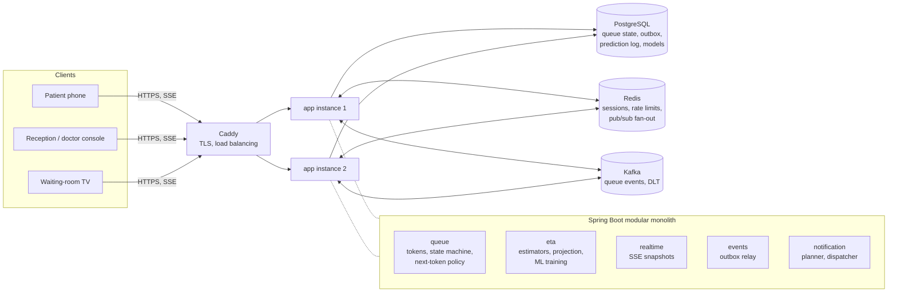

# Baari: a clinic queue that tells patients when their turn will come

> *Baari* is Hindi for "turn", as in *meri baari kab aayegi?* ("when will my turn come?").

In many Indian clinics, patients wait one to two hours for a five-minute consultation without any idea
when they will be called. They cannot step out, because missing the call means starting over.

With Baari, a patient **scans a QR code at the clinic, gets a token, and watches a live, honest
estimate of the wait on their phone**: "your turn in about 20 to 30 min". Reception and doctors run
the queue from a simple web console, and a TV in the waiting room shows who is being served. The
estimate comes from the clinic's own history and is checked against what actually happened.

Built as a portfolio project for Java backend roles: Java 21, Spring Boot 4, PostgreSQL, Redis, Kafka.

| | |
|---|---|
| **Live demo** | *to be added once deployed* (simulated reception and doctor keep the demo queue moving) |
| **Run it yourself** | [3 commands](#run-it-locally-3-commands) |
| **ETA accuracy** | [table below](#how-accurate-is-the-estimate), full report in [`docs/eta-evaluation.md`](docs/eta-evaluation.md) |

---

## What it does

- **Patients** join by QR (no app, no login), get a token like `A-017`, and see their position and a
  wait range that updates live. They can cancel. A rotating QR on the TV stops people joining from home.
- **Reception** opens the day, adds walk-ins, marks priority (elderly, pregnant, disabled) and
  emergencies, and calls, starts, completes, marks no-shows and recalls them.
- **Doctors** call their next patient. A queue can be served by one doctor or a pool of doctors.
- **The TV** shows "now serving" and the next tokens, updated instantly.
- **Clinic admins** manage doctors, queues and staff, and see how accurate the estimates were.

## Architecture



One deployable application, split into [Spring Modulith](https://spring.io/projects/spring-modulith)
modules (`clinic`, `identity`, `queue`, `eta`, `realtime`, `events`, `notification`, `web`) whose
boundaries are verified by a test. `queue` never calls `eta` or `notification`; it publishes events.

A queue change goes through these steps:
1. The change and an outbox row are written in one Postgres transaction.
2. The relay publishes the row to Kafka.
3. Idempotent consumers record the actual waits and plan notifications.
4. In parallel, the instance publishes the change on Redis.
5. Every instance rebuilds snapshots for its own open SSE streams.

The two app instances in production exist to prove that step 5 works. A stream held on one instance
receives a call made on the other, and CI checks this on every push.

## Key design decisions

Each decision has an ADR in [`docs/adr/`](docs/adr):

| Decision | Why | ADR |
|---|---|---|
| Token numbers come from a counter row per queue day, taken under its row lock | A database sequence leaves gaps on rollback; a row lock gives gap-free, per-day numbers | [0003](docs/adr/0003-queue-day-counter-row.md) |
| Call-next is serialized by the same row lock, not `SKIP LOCKED` | `SKIP LOCKED` would let two doctors skip the patient who should be next; the queue is short, so one lock is cheap | [0004](docs/adr/0004-serialize-call-next.md) |
| Transactional outbox, relay to Kafka, dedup table in consumers | No event is lost if Kafka is down and no side effect happens twice if one is redelivered | [0005](docs/adr/0005-transactional-outbox.md), [0011](docs/adr/0011-outbox-relay-kafka-consumers-and-notifications.md) |
| Staff sessions in Redis rather than JWT | Server-rendered app; logout and disabling a user take effect immediately | [0007](docs/adr/0007-sessions-over-jwt.md) |
| SSE with full snapshots, fanned out over Redis pub/sub | One-way updates need no WebSocket; snapshots make a missed message harmless | [0008](docs/adr/0008-sse-live-updates-redis-fanout.md) |
| The ETA reuses the real next-token policy to project the queue | The predicted order is always the order in which patients will actually be called | [0010](docs/adr/0010-eta-v1-rolling-stats-projection-and-prediction-log.md) |
| Every model is backtested against a simple average on later days | An estimate is only worth showing if it beats "6 minutes per patient" | [0012](docs/adr/0012-simulator-backtest-and-range-calibration.md), [0013](docs/adr/0013-ml-consultation-length-model.md) |
| Rate limits in Redis, CSP with nonces, actuator on a private port | Hardening before going public | [0014](docs/adr/0014-hardening-limits-headers-actuator.md) |

## How accurate is the estimate?

The estimate is the predicted wait until the consultation starts, shown as a range. The backtest
replays 14 simulated clinic days through the real projection code. Each estimator only sees history
from before the day it predicts. Predictions are scored at the points where the app makes them: when
the patient joins, and at 10, 5, 3 and 1 places to go.

| Estimator | Wait MAE | p90 error | Range holds the actual wait |
|---|---:|---:|---:|
| Default (6 min per patient) | 8.5 min | 21.6 min | 44% |
| Rolling per-doctor statistics | 7.4 min | 17.9 min | 45% |
| Rolling + nightly range calibration (**served**) | 7.4 min | 17.9 min | **66%** (target 60 to 70%) |
| ML, linear model of consultation length (Tribuo) | 7.4 min | 17.6 min | 46% |
| ML, regression tree (Tribuo) | 7.5 min | 18.0 min | 44% |

Interpretation:
- **Rolling statistics cut the error by 13%** compared with the default.
- **Calibration makes the range honest.** It widens the range every night until about two-thirds of
  actual waits fall inside it.
- **The ML models tie with Rolling on simulated data**, so they are not promoted. A model replaces the
  current one only if it is 5% better on held-out days. The pipeline (nightly training, promotion,
  serving, fallback) runs, and real clinic data will show whether ML is worth it.
- **All estimates lean short**, because late doctor arrivals are not modelled. The full report covers
  this: [`docs/eta-evaluation.md`](docs/eta-evaluation.md).

## Concurrency guarantees, and the tests that prove them

All of these are integration tests against real PostgreSQL in Testcontainers (no H2). The tests
start the competing requests together on purpose (`Race` helper).

| Guarantee | Test |
|---|---|
| 200 simultaneous joins get the numbers 1 to 200, no gaps, no duplicates | `TokenServiceIT.twoHundredConcurrentJoinsGetNumbersOneToTwoHundred` |
| 50 retries with the same idempotency key create one token | `TokenServiceIT.fiftyRequestsWithTheSameKeyMakeOneToken` |
| One phone has at most one active token per queue, even when racing | `TokenServiceIT.samePhoneWithDifferentKeysGetsOneActiveToken` |
| Joins racing with closing the day never leave a waiting token in a closed day | `TokenServiceIT.joinsRacingWithCloseNeverLeaveAWaitingTokenInAClosedDay` |
| Two doctors calling at once never get the same patient | `TokenActionServiceIT.twoDoctorsCallingAtOnceNeverGetTheSamePatient` |
| Start and no-show at the same moment: exactly one wins | `TokenActionServiceIT.startAndNoShowAtOnceOnlyOneWins` |
| A double-clicked "complete" completes once | `TokenActionServiceIT.aDoubleClickedCompleteCompletesOnce` |
| Concurrent "open day" requests create one day | `QueueDayServiceIT.concurrentOpensCreateExactlyOneDay` |
| Events written while Kafka is down are delivered when it returns | `OutboxRelayIT.rowsWrittenWhileKafkaIsDownAreDeliveredWhenItReturns` |
| A redelivered event has its side effect once; a poison message goes to the dead-letter topic | `OutboxRelayIT`, `NotificationIT` |
| A live update reaches a stream held on another instance | [`ops/check-fanout.sh`](ops/check-fanout.sh), run by CI against the production stack |

The token state machine and the next-token policy are pure classes with 100% branch coverage,
enforced by JaCoCo. Under load, a k6 test sent 300 patients joining and holding live streams while
staff called every 20 s: join p95 was 73 ms, there were no errors, and numbering was gap-free
([`load/`](load), ADR 0014).

## Run it locally (3 commands)

You need Docker with Compose. Ports 80 and 443 must be free.

```bash
git clone https://github.com/Rishi5200/Baari.git && cd Baari
docker compose -f ops/docker-compose.prod.yml --env-file ops/demo.env up -d --build --wait
open http://localhost/login     # Windows: start http://localhost/login · Linux: xdg-open
```

This starts the production stack with a seeded demo clinic and a simulated reception desk that keeps
the "Dr. Sharma" queue moving (3x real speed):
- two app instances;
- Caddy;
- PostgreSQL, Redis and Kafka;
- the nightly backup job.

The demo logins and their passwords are in
[`application-dev.yml`](baari-app/src/main/resources/application-dev.yml). They are public, local-only values.

Things to try:
- **Join as a patient:** http://localhost/j/sharma-clinic/dr-sharma
- **Run the queue:** log in as `reception` or `dr-sharma`.
- **See the TV board:** open `http://localhost/display/<queueId>?key=dev-display-key`, taking the
  `queueId` from http://localhost/api/public/queues/sharma-clinic/dr-sharma. A real queue's display
  key is shown once, when the queue is created.
- **Check the cross-instance updates:** `sh ops/check-fanout.sh`

Stop it with `docker compose -f ops/docker-compose.prod.yml --env-file ops/demo.env down -v`.

### Development

```bash
docker compose -f ops/docker-compose.yml up -d                              # postgres, redis, kafka, prometheus, grafana
./mvnw -pl baari-app spring-boot:run -Dspring-boot.run.profiles=dev         # app on :8080, actuator on :8086
./mvnw verify                                                               # format check, unit and integration tests (needs Docker)
```

More commands, including the simulator, backtest and load test, are in [`CLAUDE.md`](CLAUDE.md#4-commands).
Grafana runs at http://localhost:3000 with the provisioned "Baari overview" dashboard.

### Deploying

To deploy on one VM with a domain:
1. Copy [`ops/prod.env.example`](ops/prod.env.example) to `ops/.env` and fill in the domain, the
   database password and the encryption keys.
2. Run `docker compose -f ops/docker-compose.prod.yml --env-file ops/.env up -d --build`.

Caddy gets the HTTPS certificate. Only Caddy publishes ports; the actuator stays on the internal
network. Nightly `pg_dump` files land in `BAARI_BACKUP_DIR` and should be copied off the machine.

## Tech stack

| | |
|---|---|
| Language, framework | Java 21 (records, sealed types, pattern matching, virtual threads), Spring Boot 4.1, Spring Modulith |
| Data | PostgreSQL 17, Flyway, Spring Data JPA and `JdbcClient` for the hot paths |
| Messaging, cache | Kafka (KRaft) with a transactional outbox; Redis for sessions, rate limits (Bucket4j) and pub/sub |
| UI | Server-rendered Thymeleaf, small vanilla JS, Server-Sent Events, English and Hindi |
| ML | Tribuo (linear SGD and CART regression), nightly training with promotion by backtest |
| Tests | JUnit 5, AssertJ, Testcontainers 2 (PostgreSQL, Redis, Kafka), Spring Modulith `verify()`, k6 |
| Ops | Docker (layered jar, non-root), Compose, Caddy, Prometheus, Grafana, GitHub Actions, Dependabot |

Privacy:
- Phone numbers are encrypted at rest with AES-256-GCM and looked up by an HMAC.
- Names and phones are purged after 30 days.
- Logs never contain patient data.

## Future work

- **Telegram and SMS alerts.** The notification pipeline is built and tested; the real channels are next.
- **A real-clinic pilot,** to retrain on real data and publish the real accuracy numbers.
- **Session timetables,** so the estimate knows when the doctor starts. This is the largest remaining error.
- **QR images** on the TV and the printable poster (currently a link).
- **WhatsApp notifications, appointments mixed with walk-ins, and ABDM Scan & Share** for patient
  registration with India's health ID.
